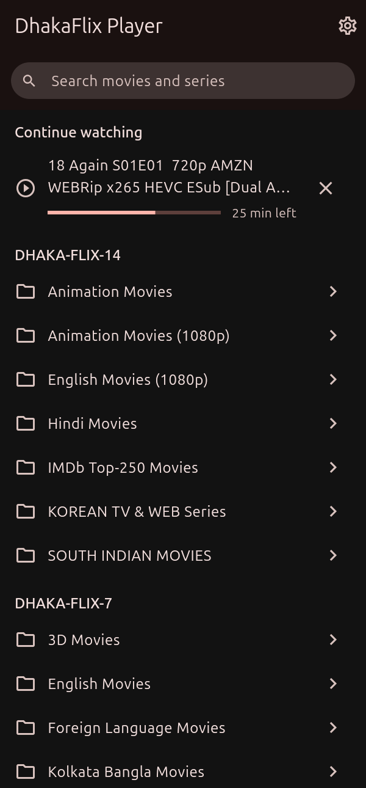
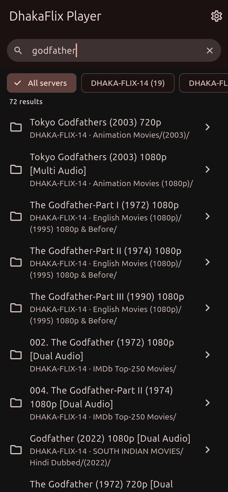
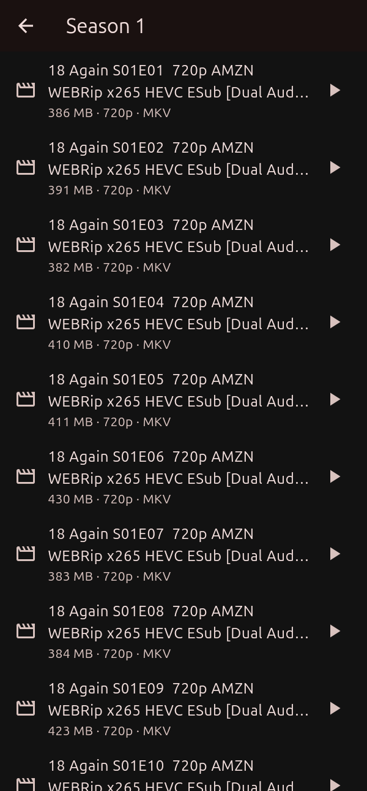
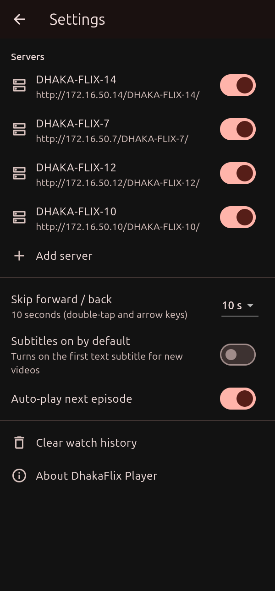
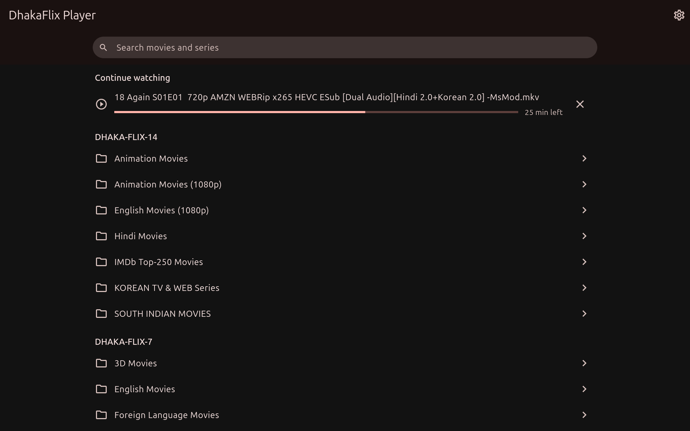

<p align="center">
  
</p>

<h1 align="center">DhakaFlix Player</h1>

<p align="center">
  <b>Unofficial lightweight player for DhakaFlix (h5ai) servers. Android, Windows, Linux.</b>
</p>

**DhakaFlix Player** is a free, open-source **FTP player** for the DhakaFlix
media servers (the h5ai file indexes many Bangladeshi ISPs offer). It comes
with four servers built in: DHAKA-FLIX-14, DHAKA-FLIX-7, DHAKA-FLIX-12 and
DHAKA-FLIX-10. Search for a movie or series, tap it
and watch straight away. You don't need to download the file first or install VLC.
It plays the formats DhakaFlix actually uses: MKV, HEVC 10-bit, AC3, DTS,
several audio languages and styled subtitles.

> **Unofficial.** This project is not affiliated with or endorsed by DhakaFlix
> or any ISP. It hosts and distributes **no content**. It only plays files that
> your own network connection can already reach.

[Download the latest release](../../releases/latest) · [বাংলা](#বাংলা)

---

## Screenshots

<p>
  
  
  
  
</p>
<p>
  
</p>

## Features

- **Search all servers at once** by name, or filter to one server. Results show the server, folder path, size and resolution. If one server is down, the others still show.
- **Four servers built in** (DHAKA-FLIX-14, -7, -12, -10). Turn each on or off, or add your own, in Settings.
- **Browse** folders. Episodes are listed in natural order (E2 before E10).
- **Plays directly**, with no conversion: H.264, HEVC/H.265 (including 10-bit), AC3, E-AC3, DTS, AAC and more. Hardware decoding is used when available.
- **Audio track menu** with language names (Hindi, English, Korean…). It remembers the language you prefer.
- **Subtitles**: built-in text subtitles (SRT, and ASS with its original styling) plus matching `.srt`/`.ass`/`.vtt` files in the same folder. You can change their size and timing.
- **Versions menu**: switch between 720p / 1080p / 2160p copies of the same title without losing your place.
- **Resume** where you stopped, and **Continue watching** on the home screen.
- **Auto-play next episode** with a 5-second countdown you can cancel.
- **Recovers from network drops** and continues from the same spot.
- Speed 0.5×–2×, double-tap to skip on phones, landscape fullscreen, and keyboard shortcuts on desktop.

## Supported platforms

| Platform | Package | Notes |
|---|---|---|
| Android 7.0+ | `.apk` (arm64-v8a, armeabi-v7a, x86_64) | Most phones: **arm64-v8a** |
| Windows 10/11 (64-bit) | Installer `.exe` or portable `.zip` | |
| Debian 12+, Ubuntu 24.04+, Linux Mint 22+ | `dhakaflix-player_<ver>_amd64.deb` | uses the system `libmpv2` |
| Ubuntu 22.04, Linux Mint 21 | `dhakaflix-player_<ver>_ubuntu22.04_amd64.deb` | uses the system `libmpv1` |

## Requirements

- **You must be on a network that can reach the DhakaFlix servers.** In practice,
  that means your ISP's network (home Wi-Fi or a wired connection from that ISP).
  On mobile data or another ISP, the app shows *"DhakaFlix is not reachable.
  Connect to the ISP network."*
- DhakaFlix uses plain HTTP. **Android only allows plain HTTP to the hosts
  built into the app**: `172.16.50.14`, `172.16.50.7`, `172.16.50.12` and
  `172.16.50.10`. On Android, a server you add with another host will only work
  after that host is added to the app and the app is rebuilt (see
  [Build from source](#build-from-source)); the app warns you when you add one.
  Windows and Linux accept any address.

## Install

### Android

1. Download `DhakaFlixPlayer-<version>-android-arm64-v8a.apk` from
   [Releases](../../releases/latest). If it doesn't install, your phone may be
   32-bit; use the `armeabi-v7a` file instead.
2. Open the file. Android will ask you to allow **Install unknown apps** for
   your browser or file manager. Allow it for that app, go back and tap **Install**.
3. If Play Protect warns about an unknown app, tap **More details → Install
   anyway**. The app isn't on the Play Store, so this warning is expected.

### Windows

1. Download `DhakaFlixPlayer-<version>-windows-x64-setup.exe` and run it. No admin
   rights are needed.
2. Or use the **portable `.zip`**: first right-click the zip → **Properties** →
   tick **Unblock** → **OK**, then extract it and run `dhakaflix_player.exe`.
   Keep the whole folder together (the `.exe` needs the DLLs and the `data` folder).

**The Windows build is not code-signed**, because trusted code-signing
certificates cost money. Because of that, Windows may block it in one of two
different ways:

- **SmartScreen: "Windows protected your PC".** Click **More info →
  Run anyway**.
- **Smart App Control: "Error 4551: An Application Control policy has blocked
  this file".** This one has **no "Run anyway" button**, and Microsoft says
  there is currently no way to allow a single app.

To check whether Smart App Control is on, open **Windows Security → App &
browser control → Smart App Control settings**. It shows **On**, **Evaluation**
or **Off**.

If Smart App Control blocks the app, you have two options:

1. **Use the Android app** (or Linux) instead.
2. **Turn Smart App Control off** in that same settings page. Read the warning
   Windows shows first. This lowers a protection for your whole PC, so it is
   your own decision for your own computer. According to
   [Microsoft's FAQ](https://support.microsoft.com/en-us/windows/security/threat-malware-protection/smart-app-control-frequently-asked-questions),
   recent Windows updates let you turn it back on later without reinstalling
   Windows. On older Windows versions, or if S mode or "optional diagnostic
   data" is off, turning it back on may need a reset or reinstall of Windows.
   You also can't return to **Evaluation** mode once you leave it.

The Android and Linux builds are not affected by any of this.

Check the download against `SHA256SUMS` from the same release if you want to be sure it's genuine:
`Get-FileHash .\DhakaFlixPlayer-*-setup.exe -Algorithm SHA256`.

### Linux (.deb)

```sh
# Debian 12+, Ubuntu 24.04+:
sudo apt install ./dhakaflix-player_<version>_amd64.deb
# Ubuntu 22.04:
sudo apt install ./dhakaflix-player_<version>_ubuntu22.04_amd64.deb
```

`apt` installs the needed libraries (libmpv, GTK) automatically. For smooth
HEVC playback, install your GPU's **VAAPI** video driver; without it, playback
still works but uses the CPU:

```sh
sudo apt install intel-media-va-driver   # Intel (newer, Broadwell+)
sudo apt install mesa-va-drivers         # AMD
```

To remove it: `sudo apt remove dhakaflix-player`.

## First run

All four built-in servers are on by default:

| Server | Address |
|---|---|
| DHAKA-FLIX-14 | `http://172.16.50.14/DHAKA-FLIX-14/` |
| DHAKA-FLIX-7 | `http://172.16.50.7/DHAKA-FLIX-7/` |
| DHAKA-FLIX-12 | `http://172.16.50.12/DHAKA-FLIX-12/` |
| DHAKA-FLIX-10 | `http://172.16.50.10/DHAKA-FLIX-10/` |

In **Settings → Servers** you can turn a server off (it disappears from Home
and search) or **Add server** with its full folder address. Settings also has the skip interval, subtitles on by
default, auto-play next episode and clear history.

## Troubleshooting

| Problem | What to try |
|---|---|
| "DhakaFlix is not reachable" | Connect to your ISP's Wi-Fi or wired network. Open the address in a browser to check that it loads. |
| A video won't play | Some very old files (FLV/WMV) may fail. Open an issue with the file path. |
| No picture-based subtitles | PGS/DVD (image) subtitles aren't supported yet; only text subtitles are. |
| Choppy HEVC on Linux | Install the VAAPI driver (see above). |
| Windows: "Windows protected your PC" (SmartScreen) | **More info → Run anyway**. The app isn't code-signed. |
| Windows: "Error 4551: An Application Control policy has blocked this file" | That's Smart App Control. There's no "Run anyway". See [Windows install](#windows) for your options. |
| Windows: portable app won't start or is blocked | Right-click the zip → **Properties** → **Unblock**, then extract it again. Keep the folder together. |
| Android: different server address won't load | Android allows plain HTTP only to the hosts built into the app; see [Requirements](#requirements). |

## Privacy

- No accounts, no analytics, no telemetry, no ads.
- The app talks **only** to the DhakaFlix address you set, and only reads from it.
- Watch history, resume positions and settings stay **on your device**.
  To remove them, use **Settings → Clear watch history**, or uninstall the app.

## Build from source

Requirements: Flutter 3.50+, plus for Android: JDK 17+ and the Android SDK;
for Linux: `clang cmake ninja-build pkg-config libgtk-3-dev libmpv-dev`.

```sh
flutter pub get
flutter run                     # debug run on a connected device or desktop
flutter test --exclude-tags live
flutter build apk --release --split-per-abi
tool/build_deb.sh               # .deb for the machine you build on
tool/build_deb_in_container.sh debian12   # portable .deb (needs podman/docker)
```

To add another built-in DhakaFlix server, add it to `defaultSources` and
`knownHosts` in `lib/core/source.dart` **and** add its host to
`android/app/src/main/res/xml/network_security_config.xml` (one `<domain>`
line per host; Android cannot match IP ranges). A unit test checks that the two
lists match.

**Release signing (maintainers).** Android release builds are signed with
the key from environment variables (`DFP_KEYSTORE`, `DFP_KEYSTORE_PASSWORD`,
`DFP_KEY_ALIAS`, `DFP_KEY_PASSWORD`). Locally, `. tool/signing.sh` loads them
from a folder outside the repository. In CI, they come from GitHub encrypted
secrets (see `.github/workflows/release.yml`). Without them, the build is
signed with the debug key and must not be published.

Pushing a tag such as `v1.0.0` runs the release workflow. It builds the APKs,
both `.deb` files and the Windows installer and portable zip, writes `SHA256SUMS`,
and publishes a GitHub Release.

## Licence

DhakaFlix Player is free software under the **GNU General Public License
v3.0**; see [LICENSE](LICENSE). Third-party components and their licences
(media_kit, mpv/libmpv, FFmpeg, Noto Sans…) are listed in
[NOTICE.md](NOTICE.md).

## Acknowledgements

- [media_kit](https://github.com/media-kit/media-kit) for the Flutter video playback layer.
- [mpv](https://mpv.io) and [FFmpeg](https://ffmpeg.org), which do the actual decoding.
- [libass](https://github.com/libass/libass) for styled subtitles.
- [h5ai](https://larsjung.de/h5ai/), the file index DhakaFlix runs on.
- [Flutter](https://flutter.dev).

---

## বাংলা

**DhakaFlix Player** হলো DhakaFlix (h5ai) সার্ভারের জন্য একটি ফ্রি, ওপেন-সোর্স
**FTP player**। মুভি বা সিরিজ খুঁজুন, ট্যাপ করুন, আর সাথে সাথে দেখুন। আগে ডাউনলোড
করতে হবে না, VLC-ও লাগবে না। MKV, HEVC 10-bit, AC3/DTS, একাধিক অডিও ভাষা আর সাবটাইটেল সাপোর্ট করে।

- **সার্ভার:** চারটি সার্ভার আগে থেকেই যুক্ত: DHAKA-FLIX-14, DHAKA-FLIX-7, DHAKA-FLIX-12 ও DHAKA-FLIX-10। সার্চ একসাথে সব সার্ভারে খোঁজে; চাইলে একটি সার্ভার বেছে নিতে পারেন। Settings থেকে যেকোনো সার্ভার বন্ধ/চালু করা যায়।
- **শর্ত:** আপনার ISP-এর নেটওয়ার্কে (যেখান থেকে DhakaFlix খোলে) সংযুক্ত থাকতে হবে।
  মোবাইল ডেটায় কাজ করবে না।
- **Android:** Releases থেকে `arm64-v8a` APK নামিয়ে ইনস্টল করুন। "Install unknown apps"
  চাইলে অনুমতি দিন।
- **Windows:** `setup.exe` চালান। অ্যাপটি code-signed নয় (সার্টিফিকেটের খরচ আছে), তাই Windows দুইভাবে আটকাতে পারে:
  - "Windows protected your PC" (SmartScreen) দেখালে **More info → Run anyway** চাপুন।
  - "Error 4551: An Application Control policy has blocked this file" দেখালে বুঝবেন এটা **Smart App Control**। এখানে "Run anyway" নেই।
    এটা চালু আছে কিনা দেখতে: **Windows Security → App & browser control → Smart App Control settings** (On / Evaluation / Off)।
    উপায় দুটি: Android অ্যাপ ব্যবহার করুন, অথবা Smart App Control বন্ধ করুন। বন্ধ করার আগে Windows-এর সতর্কবার্তা পড়ুন। এটা পুরো PC-র
    সুরক্ষা কমায়, তাই সিদ্ধান্ত আপনার নিজের। নতুন Windows আপডেটে পরে আবার চালু করা যায়। পুরনো Windows-এ আবার চালু করতে reset/reinstall লাগতে পারে।
  - Portable zip হলে: zip-এ right-click → **Properties** → **Unblock** টিক দিন, তারপর extract করুন। পুরো ফোল্ডার একসাথে রাখুন।
  - Android ও Linux-এ এই সমস্যা নেই।
- **Linux:** `sudo apt install ./dhakaflix-player_<version>_amd64.deb`
- **প্রাইভেসি:** কোনো অ্যাকাউন্ট বা ট্র্যাকিং নেই। দেখার ইতিহাস শুধু আপনার ডিভাইসেই থাকে।
- **দ্রষ্টব্য:** এটি অফিসিয়াল অ্যাপ নয়, DhakaFlix-এর সাথে এর কোনো সম্পর্ক নেই। অ্যাপটি কোনো কনটেন্ট
  হোস্ট বা বিতরণ করে না। আপনার নেটওয়ার্ক থেকে যা দেখা যায়, শুধু সেটাই চালায়।
